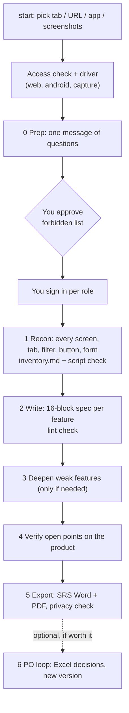

<div align="center">


**AIPOKIT** · **Point it at any running website, web app or mobile app. Get a verified spec and a ready-to-share SRS.**
*In your language. In your template. With evidence for every claim.*


🇻🇳 Hướng dẫn tiếng Việt: [HUONG-DAN-PO.md](HUONG-DAN-PO.md)

</div>

---

## Contents

1. [What it does](#1-what-it-does)
2. [Before you install](#2-before-you-install)
3. [Install](#3-install)
4. [Check that it works](#4-check-that-it-works)
5. [Your first spec](#5-your-first-spec)
6. [Update or uninstall](#6-update-or-uninstall)
7. [Troubleshooting](#7-troubleshooting)
8. [All commands](#8-all-commands)
9. [How it works](#9-how-it-works)
10. [Safety and your data](#10-safety-and-your-data)
11. [FAQ](#11-faq)
12. [What's new, status and limits](#12-whats-new-status-and-limits)
13. [For contributors](#13-for-contributors)

---

## 1. What it does

po-kit-spec is a plugin for **Claude Code**. You give it a product that is running (a website, a web app, an Android app, or screenshots of any app). Claude walks every screen, tab, filter, button and form, writes a product spec where every detail says how sure it is (seen on the app, inferred, proposed, not verified), checks open points on the app, and exports an **SRS document in Word and PDF**.

- 🔍 Reads the product that is really running, not an old wiki page.
- 🧩 Misses nothing: every element seen is listed in `inventory.md`, and a script fails the run if the spec forgets one.
- 🛡️ Safe: read-only by default, you approve a list of forbidden actions, **you sign in yourself** (Claude never handles passwords).
- 📄 One deliverable: SRS in Word + PDF (full layout or a short "classic" layout), a web page version, or your own company template.
- 🌍 English, Vietnamese or French documents; add another language with one command.
- 🔄 Re-run when the product changes: ids stay the same, only changed features are rewritten.
- 🔁 Optional: send open questions to the Product Owner as an Excel sheet and load the decisions back.

---

## 2. Before you install

Tick every line before step 3.

| You need | How to check | If missing |
| --- | --- | --- |
| A Mac (macOS 12+) or Linux | — | Windows: use WSL (Ubuntu) and follow the Linux steps inside it |
| **Claude Code**, installed and signed in | Open Terminal, type `claude --version` | Install from https://claude.com/claude-code, then run `claude` once and sign in |
| **Homebrew** (Mac only) | `brew --version` | Install from https://brew.sh |
| **Python 3** | `python3 --version` | Mac: `brew install python` · Linux: `sudo apt-get install python3 python3-venv` |
| Internet access | — | The installer downloads Graphviz, LibreOffice (if missing) and a few Python packages |
| **Git** (for Option A) | `git --version` | Mac: it is offered automatically the first time you type `git`; or use Option C (zip) |

You do **not** need to know Python, Git or the command line beyond copying the commands below.

---

## 3. Install

Pick **one** option. Option A is the easiest.

### Option A: one command in Terminal (recommended)

Open Terminal (Mac: `Cmd + Space`, type *Terminal*, Enter), paste this line and press Enter:

```bash
git clone https://github.com/vophitruonganh/AIPOKIT.git ~/AIPOKIT && bash ~/AIPOKIT/install.sh
```

The installer takes 1 to 5 minutes and does everything:

1. copies the kit to `~/.po-kit/po-kit`;
2. registers the marketplace `aipokit` with Claude Code and installs the plugin `po-kit-spec` for your user (an older install is removed first);
3. installs the export tools: Graphviz and LibreOffice (skipped if present) and the Python packages in a **private folder `~/.po-kit/venv`**, so your system Python is not touched;
4. checks the environment.

**It worked if the end of the output looks like this:**

```text
✔ Successfully added marketplace: aipokit
✔ Successfully installed plugin: po-kit-spec@aipokit (scope: user)
    Version: 1.6.1
    Status: ✔ enabled
Setup done. Python modules are in /Users/<you>/.po-kit/venv
Environment OK

== Done. Open a NEW Claude Code session and type /po-kit-spec:start
```

Lines starting with `WARNING: Cache entry…` or `FutureWarning: The fitz API…` are harmless. If you see an error, go to [Troubleshooting](#7-troubleshooting).

### Option B: inside Claude Code (no Terminal)

Type these three lines in Claude Code, one at a time:

```text
/plugin marketplace add vophitruonganh/AIPOKIT
/plugin install po-kit-spec@aipokit
/po-kit-spec:setup
```

The last one checks the export tools and installs what is missing after you say yes. If the repository is private, you must be signed in to GitHub on this computer with access to it.

### Option C: from a zip file (offline or no Git)

Download the repository as a zip (green **Code** button → **Download ZIP**) or use the `po-kit.zip` you were given, put it in Downloads, then in Terminal:

```bash
unzip -oq ~/Downloads/AIPOKIT-main.zip -d /tmp/aipokit && bash /tmp/aipokit/*/install.sh
```

(Replace the file name if yours is different, e.g. `po-kit.zip`.)

> [!NOTE]
> Claude Code does not let Claude install plugins into itself. If you ask Claude to install the kit, it will hand you these same commands to run.

---

## 4. Check that it works

1. In Terminal: `claude plugin list` shows **po-kit-spec@aipokit**, version **1.6.1**, **enabled**.
2. Close any open Claude Code window and **start a new session** (commands load only in new sessions).
3. In the new session type `/po-kit-spec:` and you see the list of commands (`start`, `setup`, `export-srs`…).
4. Optional: type `/po-kit-spec:setup`. Claude answers "Environment OK" or installs what is missing.

---

## 5. Your first spec

**1. Make a folder for this product and open Claude Code in it.** All files (spec, inventory, Word, PDF) are saved there.

```bash
mkdir -p ~/specs/my-product && cd ~/specs/my-product && claude
```

**2. Start:**

```text
/po-kit-spec:start
```

Claude shows a numbered menu: your open browser tabs, Android apps running on a connected device, *Enter a URL*, or *Use screenshots from a folder*. Pick a number. You can also give the address directly: `/po-kit-spec:start https://your-app.example.com`.

**3. Answer one message of questions.** Claude first checks it can reach the product, then asks once:

| Question | Typical answer |
| --- | --- |
| What is the spec for? | "Record how it works today" or "Basis for rebuilding / testing" |
| Environment? | production, staging or dev (production = strictly read-only) |
| Which roles? | e.g. "Admin, Staff" (no passwords!) |
| Forbidden actions | reply **ok** to accept the safe default list |
| Languages | e.g. "spec in English, document in Vietnamese" |

**4. Sign in when asked.** For each role Claude says *"Sign in as Admin in the window I opened, then reply done"*. Sign in yourself and reply `done`. Tip: use a separate browser profile per role so you never have to sign out.

**5. Wait.** Claude walks the product, writes and checks the spec on its own. It only comes back to you to switch role or if access is lost.

**6. Get the documents.** At the end you receive, in your folder (or in Claude Docs if you chose it as storage): the SRS in Word (`.docx`) and PDF, a coverage table, `inventory.md` and the spec files (`md/`). Claude may then ask once whether you want an Excel sheet of open questions for the Product Owner; say no if you only need the document.

---

## 6. Update or uninstall

**Update:** in Terminal run `cd ~/AIPOKIT && git pull && bash install.sh` (Option A), or inside Claude Code `/plugin marketplace update aipokit` (Option B). Your specs are not touched.

**Uninstall:**

```bash
claude plugin uninstall po-kit-spec@aipokit
claude plugin marketplace remove aipokit
rm -rf ~/.po-kit
```

---

## 7. Troubleshooting

| What you see | What to do |
| --- | --- |
| `claude: command not found` | Claude Code is not installed or not on your PATH. Install it (section 2), open a new Terminal window, try again. |
| `brew: command not found` (Mac) | Install Homebrew from https://brew.sh, open a new Terminal window, run the installer again. |
| `python3: command not found` | Mac: `brew install python` · Linux: `sudo apt-get install python3 python3-venv`. |
| `error: externally-managed-environment` | You ran `pip install` yourself. Not needed: run the installer, it uses its own `~/.po-kit/venv`. |
| `No such file or directory … install.sh` | The path is wrong. Drag the `install.sh` file from Finder into Terminal after typing `bash ` and press Enter. |
| `fatal: destination path '~/AIPOKIT' already exists` | You installed before: run `cd ~/AIPOKIT && git pull && bash install.sh`. |
| `Repository not found` / asks for a password | The repository is private: sign in to GitHub on this computer (`gh auth login`) or use Option C with a zip. |
| `Permission denied` | Run it with `bash` in front: `bash ~/Downloads/po-kit/install.sh`. |
| `/po-kit-spec:` commands do not appear | Start a **new** Claude Code session. Check `claude plugin list` shows it enabled. |
| `MISSING: dot` or `MISSING: soffice` | Mac: `brew install graphviz` / `brew install --cask libreoffice`. Linux: `sudo apt-get install graphviz libreoffice`. Then `/po-kit-spec:setup`. |
| `MISSING python module` | Run `bash ~/.po-kit/po-kit/plugins/po-kit-spec/scripts/setup.sh`. |
| The start menu shows no browser tabs | That Claude Code session has no browser-control tool. Paste the URL instead, or connect the Chrome extension and start again. |
| Claude says it cannot reach the site | The site is behind a VPN or IP allowlist. Claude switches to a browser on your machine when it can; otherwise connect the VPN and retry. |
| `WARNING: Cache entry deserialization failed` / `FutureWarning: fitz` | Harmless, ignore. |

Still stuck? Copy the full Terminal output and send it to the person who shared the kit.

---

## 8. All commands

Type them inside Claude Code. Most people only need the first one.

| Command | What it does |
| --- | --- |
| `/po-kit-spec:start [URL or app]` | **Start here.** Pick an open tab, a URL, a running Android app or a screenshots folder, then run everything up to the export |
| `/po-kit-spec:setup` | Check and install the export tools |
| `/po-kit-spec:export-srs <folder> [config]` | Build the Word + PDF SRS again (full layout, or `"template": "classic"` in config for the short layout) |
| `/po-kit-spec:export-reader <folder>` | One web page version with search and contents |
| `/po-kit-spec:export-custom <template> [folder]` | Export into your company template; compares pages with the template and lists differences |
| `/po-kit-spec:build-spec <url or app>` | Phases 0 to 4 only (what `start` runs) |
| `/po-kit-spec:verify <module>` | Re-check open questions on the product, grouped by role |
| `/po-kit-spec:lint <folder> [lang]` | Quality check and coverage table |
| `/po-kit-spec:po-sheet <folder>` | Optional: Excel sheet of open questions for the Product Owner |
| `/po-kit-spec:po-import <folder> <answers.xlsx>` | Optional: load the PO's decisions, new version, change list |
| `/po-kit-spec:diff <old> <new>` | Change list between two spec versions |
| `/po-kit-spec:setup-standards [templates]` | Record your team's own process, templates and languages (optional, once) |
| `/po-kit-spec:add-language <code>` | Add a document language (shipped: `en`, `vi`, `fr`) |

---

## 9. How it works



| Phase | Who | Output |
| --- | --- | --- |
| Access check | Claude | picks the driver: a browser (web), `adb` (Android) or your screenshots; switches to a browser on your machine if its network is blocked |
| 0 Prep | you, once | brief: target, purpose, environment, roles, forbidden actions, languages |
| 1 Recon | `spec-recon` agent | `inventory.md` of every element, sitemap, API list (web), roles, glossary |
| 2 Write | `spec-writer` agents | each feature in a fixed 16-block template with numbered rules, criteria and test cases |
| 3 Deepen | `spec-writer`, `spec-reviewer` | rewrites only features under the quality bar |
| 4 Verify | `spec-verifier` agents | every open question answered Verified / Partly verified / Cannot verify (with reason) |
| 5 Export | scripts | SRS `.docx` + `.pdf`, coverage table, privacy check |
| 6 PO loop (optional) | scripts + `spec-writer` | Excel sheet, decisions loaded back, new version, change list |

Quality is checked by scripts, not by reading: `inventory_check.py` (nothing missed), `spec_lint.py` (structure, numbering, test mix), `privacy_check.py` (no personal data). When the product changes, run `start` again: `inventory_diff.py` keeps every id and only changed features are rewritten.

---

## 10. Safety and your data

- **Read-only by default.** On production nothing is submitted. On staging/dev Claude may submit a form with wrong data to read the error, or create records named `TEST …` within a small budget.
- **Never:** payments, messages or notifications to real people, changes to passwords, permissions or settings, editing other people's records, exporting data, signing in or out, printing tokens, copying personal data into documents.
- **You approve the forbidden list** before anything touches the product. It can be made stricter, never weaker.
- **You sign in.** Claude never types, pastes or stores passwords or one-time codes.
- **Your files stay with you.** Specs and documents are written to your folder. The kit sends nothing anywhere. Run the privacy check (done automatically on export) before sharing.

Full rules: `plugins/po-kit-spec/skills/reverse-spec-builder/references/safety-rules.md` and `session-rules.md`.

---

## 11. FAQ

**Can I use it on production?** Yes, strictly read-only. More questions will end as "Cannot verify". Staging with one account per role gives a better spec.

**Does it work on mobile apps?** Android through `adb` (device or emulator). iOS or any other app: from screenshots or screen recordings you give it. A web version of the app is read with the browser.

**Will it invent things?** No. Anything not seen is labelled "proposed" or "not verified", and the lint check fails on unlabelled claims.

**Do I have to fill an Excel sheet?** No. The PO loop is optional; Claude suggests it only when the spec is a basis for building or testing and important decisions are pending.

**Can I use my company's template?** Yes: `/po-kit-spec:export-custom <template file>`.

**Which languages?** Documents in English, Vietnamese, French; add more with `/po-kit-spec:add-language`. Talk to Claude in your own language.

**Other AI tools?** `portable/` holds generated editions for Codex (skill + installer) and ChatGPT (Custom GPT pack, no crawling). See [`portable/README.md`](portable/README.md).

---

## 12. What's new, status and limits

| Version | Change |
| --- | --- |
| 1.6.1 | The SRS describes the product only: no source / environment / account lines on the cover (`source_line`, `source_detail` dropped), no "as-is, for the PO to confirm" wording, no "C. Environment" appendix in modules (not-visible items move to C), endpoints without host or survey date; survey details stay in `source/` and the run log. |
| 1.6.0 | New document look: `doc_style` presets (`slate` default: Inter, teal headings and header rows, light borders, zebra rows; `navy`, `mint`, `legacy`); clickable table of contents and list of figures (bookmarks, PDF links and outline); UML-correct diagrams (ellipse use cases with stick-figure actors, «include»/«extend» from `usecase` blocks, decision diamonds with [guard]/[else], dashed arrows for replies only, amber for unverified) and a notation table in section 1; diagram colours follow the document, auto-detected from a reference Word file (`style_detect.py`) with config override and default fallback; card-style diagrams with shadows (Chromium render); dense module links drawn as a matrix. |
| 1.5.0 | Diagrams chosen by content: a planner scores 14 diagram types from the spec (Must / Should / Could), profiles `full` / `classic` / `po` / `dev`, new `spec-diagrammer` agent and `diagram_check.py` gate; SRS gains a context diagram, cross-module link map, activity diagrams with branches, sequence, screen flow, decision table, timeline, screen map, permission matrix and a 3.4 Data requirements ERD; PNG + SVG. |
| 1.4.4 | Published on GitHub as **AIPOKIT**; marketplace renamed `aipokit` (install: `po-kit-spec@aipokit`); install from GitHub in one command. |
| 1.4.3 | `/po-kit-spec:start`: one entry point to pick an open tab, a URL, a running Android app or a screenshots folder. |
| 1.4.2 | One-step `install.sh`; `/po-kit-spec:setup`; export scripts use a private venv (`~/.po-kit/venv`), so macOS Homebrew Python works. |
| 1.4.1 | PO loop becomes optional: Claude recommends it only when worth it and asks once. |
| 1.4.0 | Works for any product (no site-specific logic); web, Android and screenshot drivers; access check; you sign in per role; production strictly read-only; one approval; stable ids across re-runs. |
| 1.3.x | PO loop (Excel, import, versions, change list); "classic" SRS layout. |
| 1.2.0 | Exhaustive walk of every tab and sub-feature, `inventory.md` and the coverage check. |

**Tested:** the installer on macOS (Apple Silicon, Homebrew Python 3.14); full runs on real web apps (one with two roles and 266 elements, 0 coverage failures); SRS export in both layouts; PO sheet export/import; `inventory_diff.py`.
**Not yet tested on a real app:** the Android and screenshot drivers; `/po-kit-spec:start` tab listing on every browser tool; the Codex and ChatGPT editions; Windows (WSL).
**Known limits:** actor detection in the SRS builder relies on sentences starting with the actor name, so languages without capital letters get coarser results; lint does not yet flag endpoint names in feature text (the reviewer agent does).

---

## 13. For contributors

<details>
<summary>Repository layout, conventions and release steps</summary>

```text
install.sh                          one-step installer (macOS / Linux)
.claude-plugin/marketplace.json     marketplace "aipokit"
plugins/po-kit-spec/
  commands/                         slash commands (start, setup, build-spec, export-srs, ...)
  agents/                           spec-recon, spec-writer, spec-verifier, spec-reviewer
  skills/reverse-spec-builder/      skill + references (session-rules, drivers, coverage, safety, ...)
  scripts/                          lint, stats, inventory check/diff, android sweep, SRS builder,
                                    PO sheet export/import, spec diff, privacy check, language packs
  examples/expense-tracker/         synthetic sample spec and config
portable/                           generated editions for Codex and ChatGPT
tools/build_portable.py             generator for portable/
HUONG-DAN-PO.md                     Vietnamese guide for Product Owners
```

- Naming: marketplace `aipokit` (repository AIPOKIT), plugins `po-kit-<tool>`, commands `/po-kit-<tool>:<task>`.
- Release: bump `version` in `plugins/<plugin>/.claude-plugin/plugin.json` and `.claude-plugin/marketplace.json`, run `claude plugin validate .`, then `python3 tools/build_portable.py`, then commit and push to `main`.
- Team settings live in `.po-kit/standards.md` in the working folder; every tool reads it.
- Data policy: the repository holds the kit only. Specs of real products, exports and test accounts are never committed.
- License: not yet chosen; add a `LICENSE` file before publishing.

</details>
